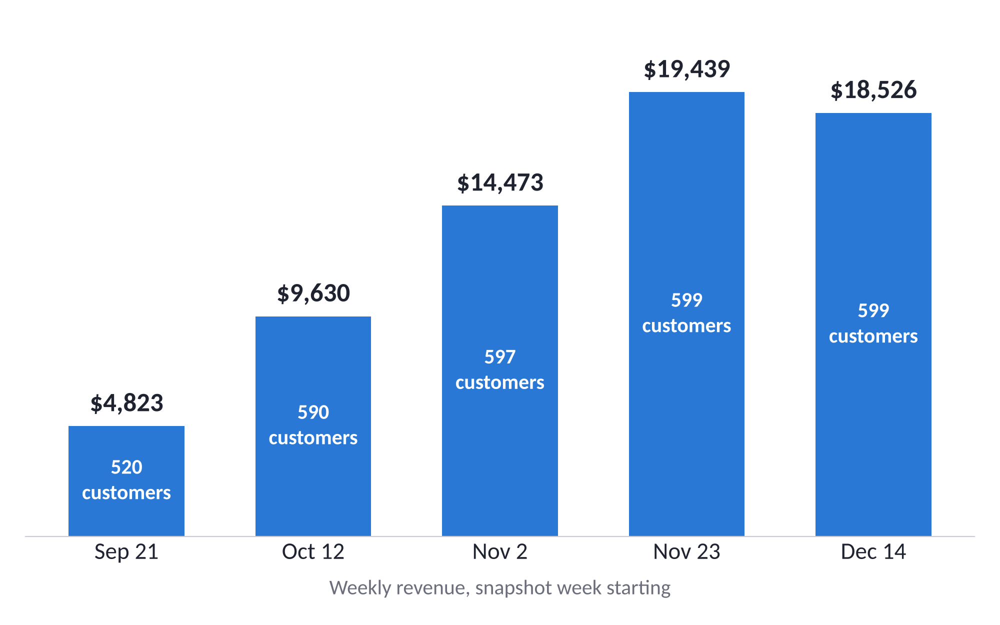
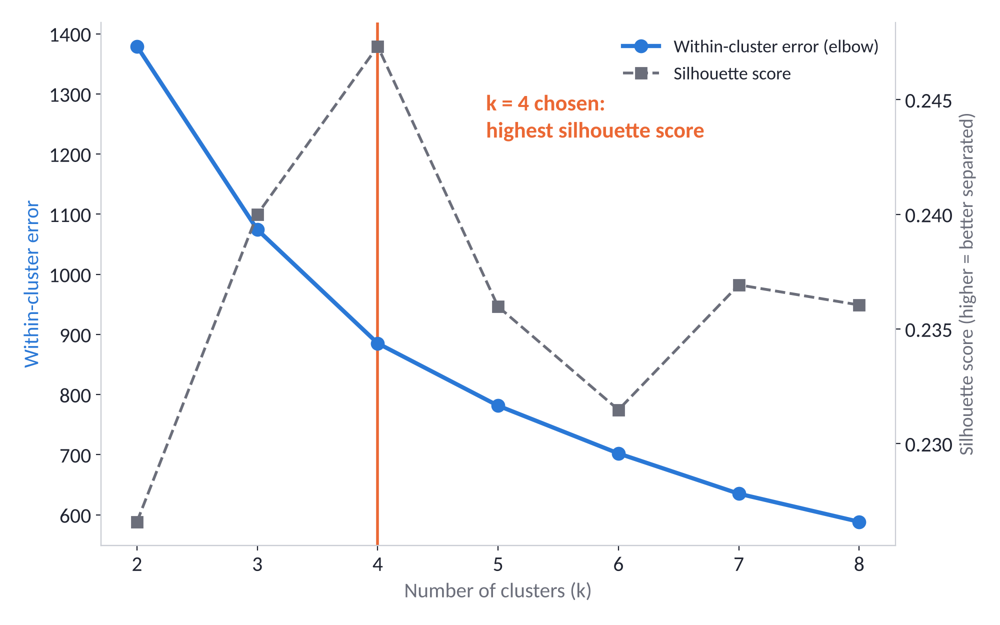
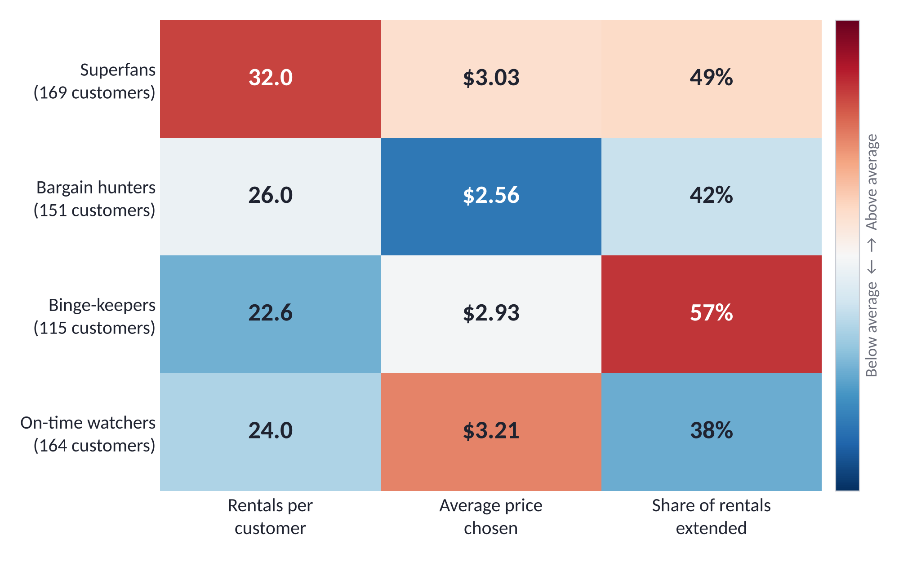
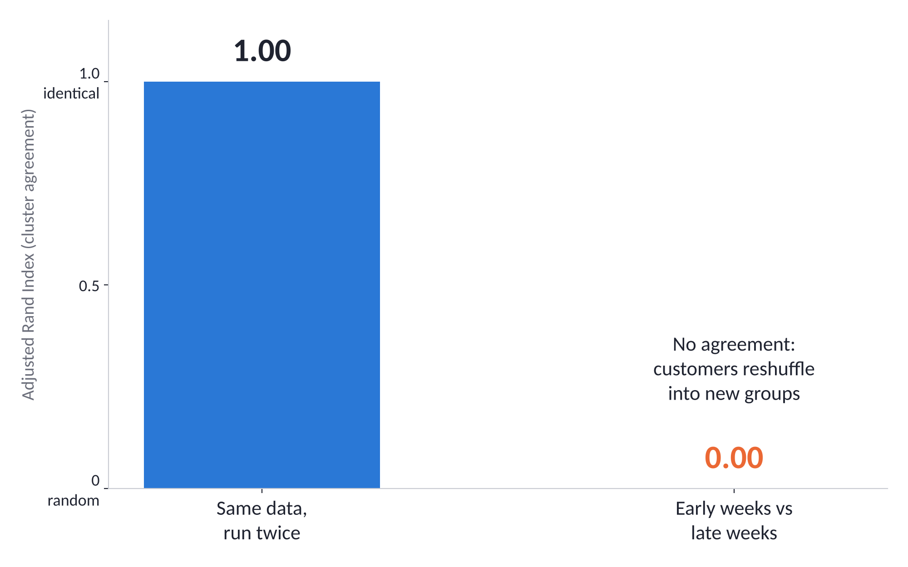
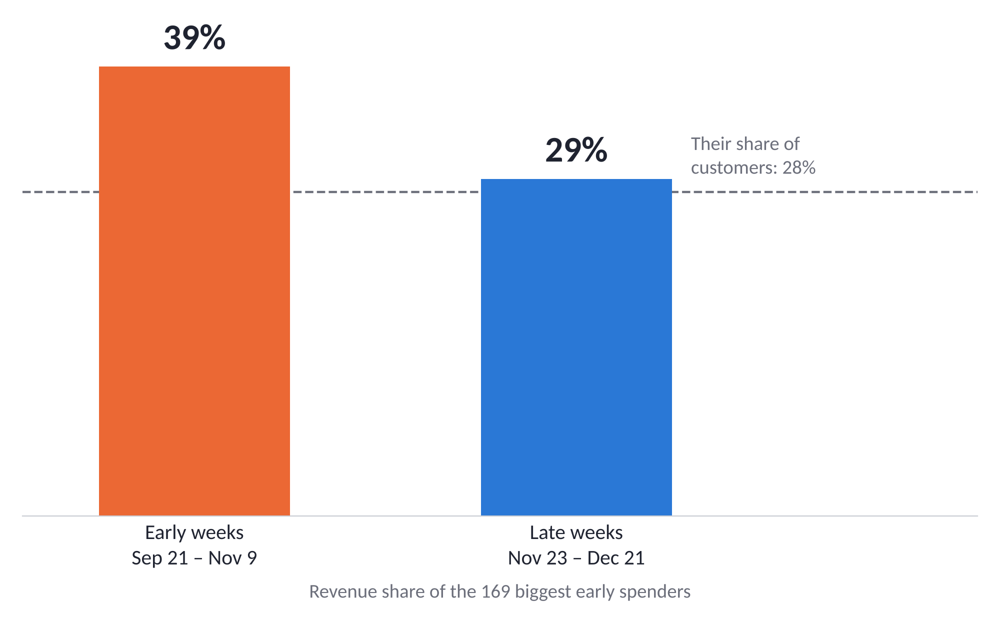
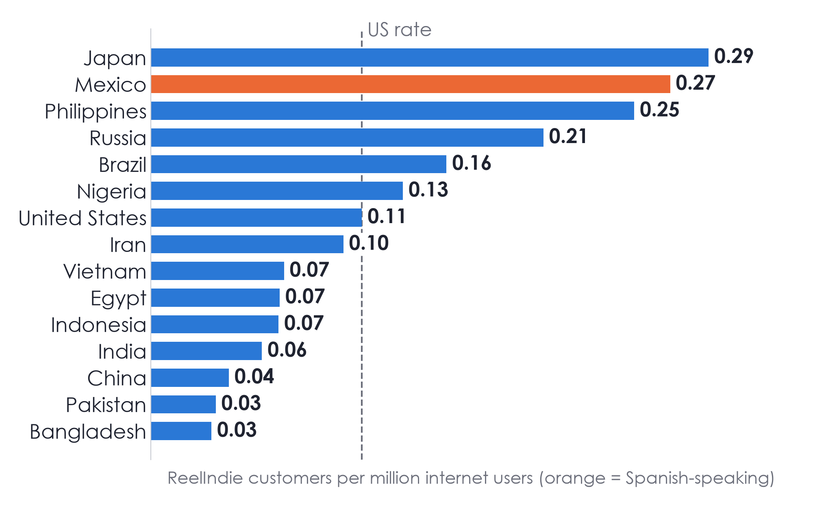

# ReelIndie Case Analysis: Loyal Fans, Flat Growth

**🏆 Room Winner (Afternoon Session), MIS 304 Case Competition, Eller College of Management, University of Arizona (Fall 2026)**

ReelIndie is an independent-film streaming platform. Its weekly revenue grew about 4x over the fall, but almost all of that growth came from the same customers: only **one** new customer joined after October. Our team was asked how ReelIndie should grow.

I built the analysis in Python, brought in outside data from the World Bank, applied machine learning to customer behavior, and rebuilt the key numbers as Microsoft Access SQL queries so every figure was checked in two tools.

---

## Key findings

| Finding | Number | Recommendation |
|---|---|---|
| Growth came from existing customers renting more (2.2 → 7.6 films a week) | **1** new customer after October | Restart customer acquisition |
| Customer segments found by k-means don't hold up over time | **39% → 29%** revenue share of top early spenders | One plan for all 599 customers |
| Films rent equally often at $0.99, $2.99 and $4.99 | **+$11.2K** if $0.99 films move to $2.99 (break-even only if 46% of renters leave) | A/B test, then roll out |
| A $1-a-day extension fee the case never mentions | **$20.2K**, 30% of all revenue | Sell "+3 days" for $2.99 at checkout |
| Filmmaker earnings per title by genre | **$58** (Sci-Fi) vs **$44** (Foreign) | Publish an earnings calculator |
| Spanish-speaking markets sign up more per internet user | **2.4x** the rate of everywhere else | Spanish subtitles + referrals |

Together the recommendations add roughly **$30K of new revenue every five weeks** on a $67K base, with no new staff or systems.



---

## Machine learning: segmenting customers, then testing the segments

I described each of the 599 customers with three features (rentals, average price chosen, share of rentals extended), standardized them, and clustered them with **k-means** (scikit-learn).

**1. Choosing k.** I tested 2 to 8 clusters. k = 4 had the highest silhouette score (0.247).



**2. What the clusters look like.** Superfans rent the most, Bargain hunters choose the cheapest films, Binge-keepers extend 57% of their rentals.



**3. Validating the clusters over time.** Re-running k-means on the same data gives identical clusters (Adjusted Rand Index 1.00). But clustering the early weeks and late weeks separately gives an ARI of **0.00**: customers completely reshuffle between groups.



**4. The business consequence.** The 169 biggest early spenders fell from 39% of revenue to 29%, back to their 28% share of customers. Price and extension habits barely repeat either (r = 0.04 and 0.07).



**Why it matters:** the clusters looked convincing, but testing them before presenting changed our strategy from four targeted plays to one plan for every customer.

Regression models (statsmodels) added a second check: film attributes (genre, price, length, rating, special features) explain only about 3.5% of rental demand, so we focused on what ReelIndie controls: pricing, rental windows and acquisition.

---

## Outside data: World Bank internet users

Using the World Bank API (`wbgapi`), I pulled internet-use rates and population for every country and computed **ReelIndie customers per million internet users**. That lets a country like China be compared fairly with one like Mexico.



---

## Cross-checked in Microsoft Access

The key numbers were rebuilt as Access SQL queries ([`access/ReelIndie_Access_Queries.sql`](access/ReelIndie_Access_Queries.sql)) and match Python. The only difference is a single never-returned $3.99 rental that Access excludes: $20,192 in Access vs $20,195 in Python.

---

## Tools

Python (pandas, NumPy, scikit-learn, statsmodels, matplotlib), World Bank API (`wbgapi`), Microsoft Access / SQL, PowerPoint

## How to run

```bash
pip install -r requirements.txt
# put the exported CSV tables in data/ (see data/README.md)
python my_reelindie.py      # full analysis + slide charts (deck_charts/)
python ml_evidence.py       # machine learning evidence charts (ml_charts/)
```

## Project structure

```
my_reelindie.py      Full analysis, steps 0-8, and the slide charts
ml_evidence.py       k selection, cluster profiles, stability test (ARI)
access/              Access SQL queries used to cross-check the numbers
charts/              Chart images used in the presentation and this README
data/                Not included (course data); see data/README.md
```

## Team

Team 56: Nathan Skiera, Jack Dodge, Keira Richards, Evan Lee and Brennan Ashley.
Thanks to Dr. Weber and the MIS 304 judges.

*The ReelIndie case and database are MIS 304 course materials and are not included in this repository.*
